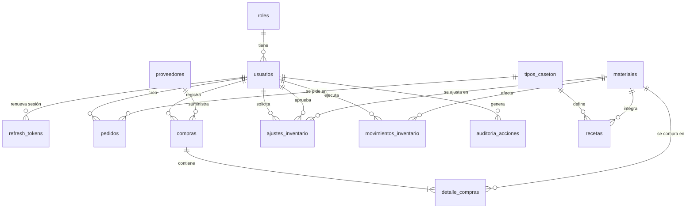
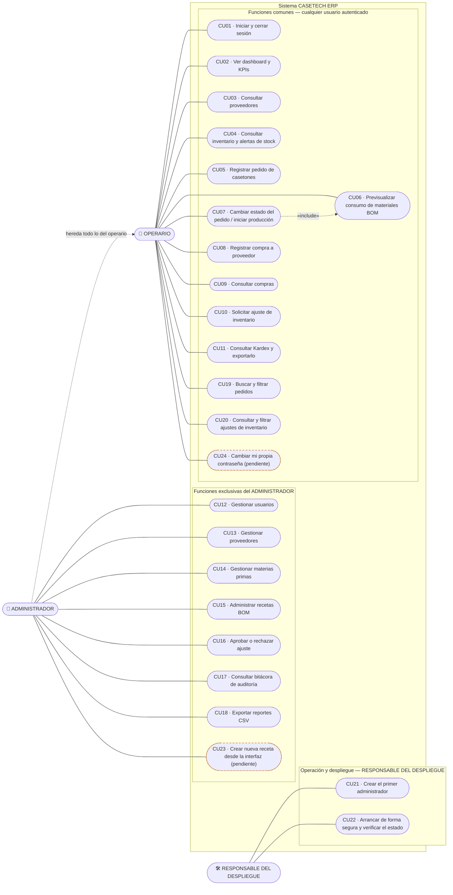
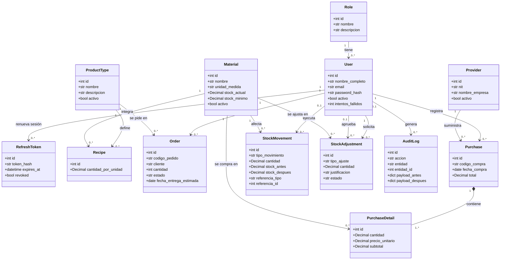
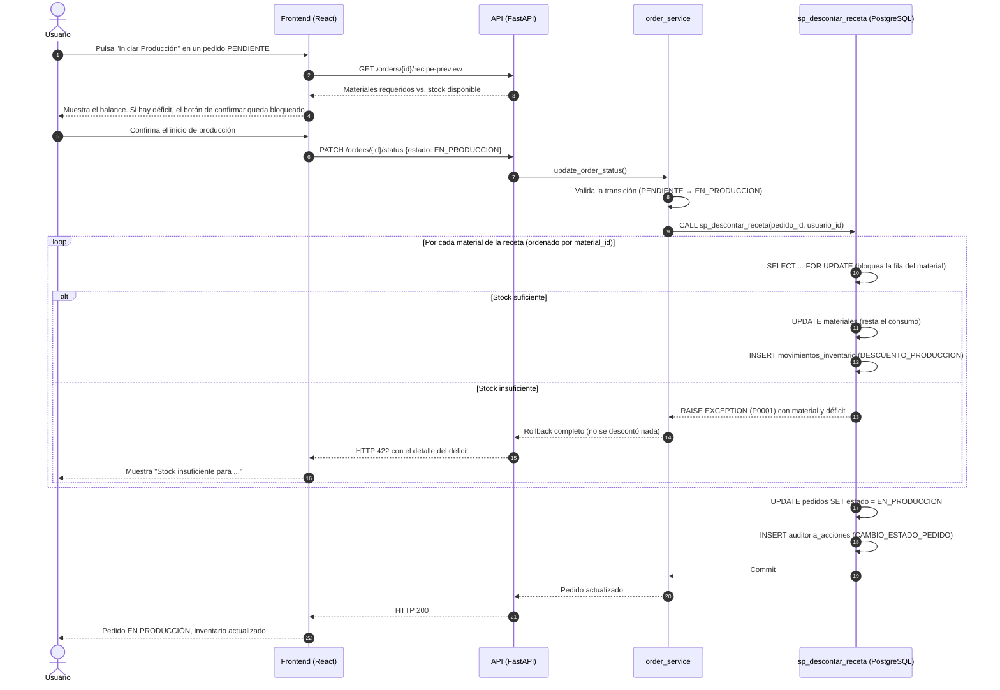
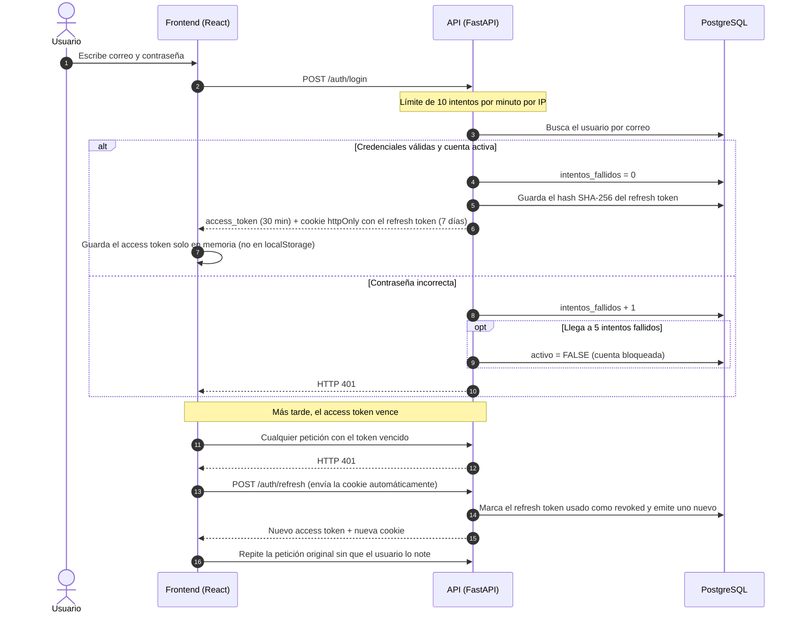
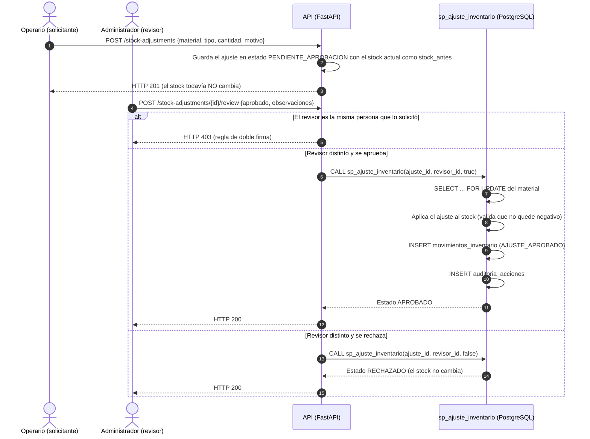
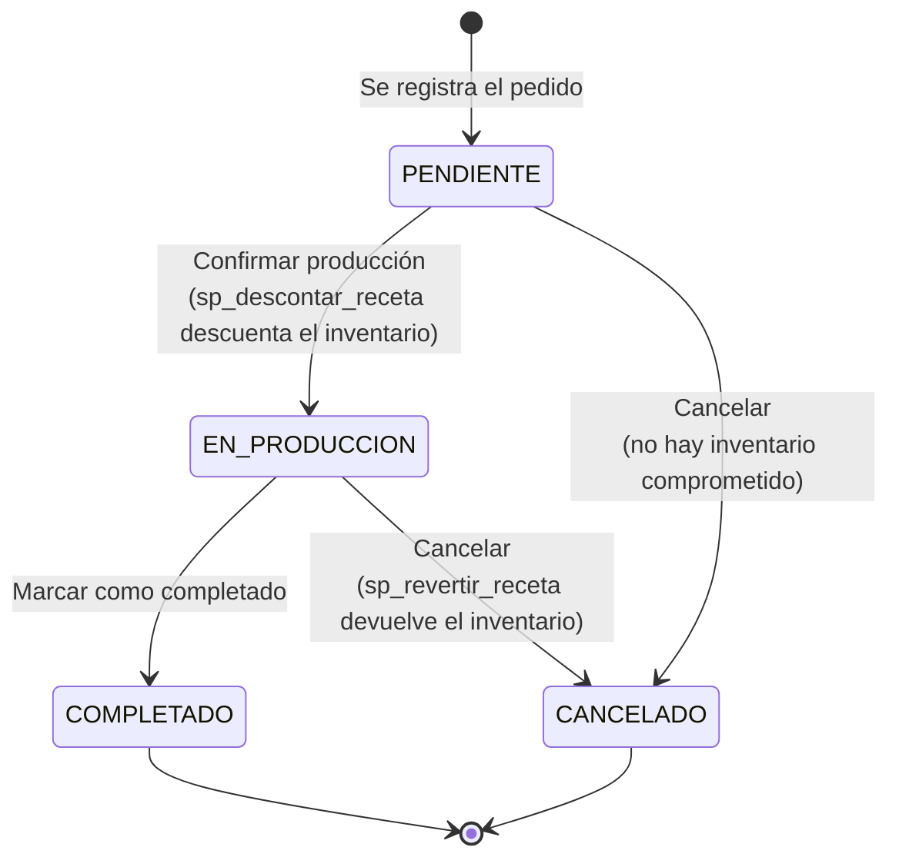
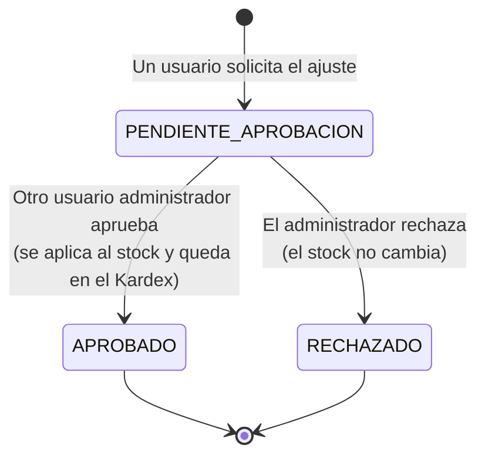

# Modelado y Diagramas — CASETECH ERP

> **Versión:** 1.0.0
> **Equipo:** Andrés Fernández · Oscar Ruiz · Javier Sepúlveda
> **Propósito:** conclusión de la documentación general del proyecto: modelo entidad-relación, modelo relacional, casos de uso, diagrama de clases, diagramas de secuencia y diagramas de estados.
> **Cómo se ve:** todos los diagramas están en [Mermaid](https://mermaid.js.org/), así que GitHub los dibuja directamente al abrir este archivo.
> **Fuente de verdad:** cada diagrama se construyó leyendo el código real (`backend/app/models`, `backend/app/api/v1/endpoints`, `backend/app/services` y los Stored Procedures de `backend/alembic/versions`), no la documentación vieja.

## Tabla de contenidos

1. [Modelo Entidad-Relación (MER)](#1-modelo-entidad-relación-mer)
2. [Modelo Relacional (MR)](#2-modelo-relacional-mr)
3. [Casos de uso](#3-casos-de-uso)
4. [Diagrama de clases del dominio](#4-diagrama-de-clases-del-dominio)
5. [Diagramas de secuencia](#5-diagramas-de-secuencia)
6. [Diagramas de estados](#6-diagramas-de-estados)
7. [Trazabilidad entre diagramas y documentos](#7-trazabilidad-entre-diagramas-y-documentos)

---

## 1. Modelo Entidad-Relación (MER)

El MER completo, con todos los atributos, tipos de dato y llaves de las 13 tablas, está en [`04-modelo-datos.md`, sección 1](./04-modelo-datos.md#1-diagrama-entidad-relación-conceptual). Aquí va una vista **resumida por dominios** para entender de un vistazo cómo se conectan los módulos (se muestran solo las entidades y sus relaciones, sin columnas):



**Cómo leer las relaciones (notación de "pata de gallo"):**

| Símbolo | Significado |
|---|---|
| `\|\|` | exactamente uno |
| `o{` | cero o muchos |
| `\|{` | uno o muchos |

**Decisiones de diseño que explican el MER:**

- **`recetas` resuelve una relación muchos a muchos.** Un tipo de casetón usa muchos materiales y un material se usa en muchos tipos de casetón; la tabla `recetas` guarda además la cantidad de material por unidad producida (`cantidad_por_unidad`).
- **`detalle_compras` resuelve otra muchos a muchos** entre `compras` y `materiales`, y guarda cantidad, precio unitario y subtotal de cada línea.
- **`movimientos_inventario` es el Kardex.** Es un registro que solo se agrega (nunca se edita ni se borra) y guarda el stock antes y después de cada movimiento. `referencia_id` + `referencia_tipo` apuntan al documento que lo originó (un pedido, una compra o un ajuste) sin ser una llave foránea, porque pueden apuntar a tres tablas distintas.
- **`ajustes_inventario` referencia dos veces a `usuarios`** (`solicitado_por` y `aprobado_por`): es lo que permite la regla de doble firma.
- **`refresh_tokens` guarda solo el hash SHA-256** del token de renovación; el token real vive únicamente en una cookie `httpOnly`.

---

## 2. Modelo Relacional (MR)

El MR es el paso siguiente al MER: cada entidad pasa a ser una relación (tabla) y cada relación 1:N pasa a ser una llave foránea en el lado "muchos". Notación: **PK** = llave primaria (subrayada en la teoría), **FK** = llave foránea, **UK** = valor único, `→` indica a qué tabla apunta la FK y entre corchetes la acción al borrar.

```text
roles(
    id PK, nombre UK, descripcion, created_at)

usuarios(
    id PK, nombre_completo, email UK, password_hash,
    rol_id FK → roles.id [RESTRICT],
    activo, intentos_fallidos, created_at, updated_at)

refresh_tokens(
    id PK, usuario_id FK → usuarios.id [CASCADE],
    token_hash UK, expires_at, revoked, created_at)

proveedores(
    id PK, nit UK, nombre_empresa, contacto_nombre, contacto_telefono,
    contacto_email, direccion, activo, created_at, updated_at)

materiales(
    id PK, nombre UK, unidad_medida, stock_actual, stock_minimo,
    activo, created_at, updated_at)

tipos_caseton(
    id PK, nombre UK, descripcion, activo, created_at)

recetas(
    id PK,
    tipo_caseton_id FK → tipos_caseton.id [RESTRICT],
    material_id     FK → materiales.id    [RESTRICT],
    cantidad_por_unidad, created_at,
    UK (tipo_caseton_id, material_id))

pedidos(
    id PK, codigo_pedido UK, cliente,
    tipo_caseton_id FK → tipos_caseton.id [RESTRICT],
    cantidad, estado, fecha_entrega_estimada,
    creado_por FK → usuarios.id [RESTRICT],
    observaciones, created_at, updated_at)

compras(
    id PK, codigo_compra UK,
    proveedor_id   FK → proveedores.id [RESTRICT],
    fecha_compra, total,
    registrado_por FK → usuarios.id    [RESTRICT],
    observaciones, created_at)

detalle_compras(
    id PK,
    compra_id   FK → compras.id    [CASCADE],
    material_id FK → materiales.id [RESTRICT],
    cantidad, precio_unitario, subtotal)

movimientos_inventario(
    id PK,
    material_id   FK → materiales.id [RESTRICT],
    tipo_movimiento, cantidad, stock_antes, stock_despues,
    referencia_id, referencia_tipo,
    ejecutado_por FK → usuarios.id   [SET NULL],
    created_at)

ajustes_inventario(
    id PK,
    material_id    FK → materiales.id [RESTRICT],
    tipo_ajuste, cantidad, stock_antes, stock_despues, justificacion, estado,
    solicitado_por FK → usuarios.id   [RESTRICT],
    aprobado_por   FK → usuarios.id   [RESTRICT],
    fecha_solicitud, fecha_aprobacion)

auditoria_acciones(
    id PK,
    usuario_id FK → usuarios.id [SET NULL],
    accion, entidad, entidad_id, payload_antes, payload_despues,
    ip_origen, created_at)
```

**Normalización (3FN):** cada tabla tiene llave primaria simple, ningún atributo depende de una parte de la llave ni de otro atributo que no sea llave. Los únicos datos derivados (`detalle_compras.subtotal`, `compras.total`, `stock_antes`/`stock_despues`) se guardan a propósito como *instantánea histórica*: si cambia un precio o el stock más adelante, el documento original no debe cambiar.

**Reglas de integridad que muestra el MR:**

- `ON DELETE RESTRICT` casi en todas las llaves: no se puede borrar un proveedor, material o usuario que ya tiene historia. Por eso el sistema usa **borrado lógico** (`activo = FALSE`).
- `CASCADE` solo donde la fila hija no tiene sentido sin su padre: las líneas de una compra y los tokens de un usuario.
- `SET NULL` en el Kardex y en la auditoría: si se elimina un usuario, el historial se conserva y solo pierde el nombre de quien lo ejecutó.
- Valores permitidos controlados con `CHECK`: `pedidos.estado`, `ajustes_inventario.tipo_ajuste` y `estado`, `movimientos_inventario.tipo_movimiento` (detalle en [`04-modelo-datos.md`, sección 6](./04-modelo-datos.md#6-enumeraciones-y-dominios)).

---

## 3. Casos de uso

Hay dos actores. **ADMINISTRADOR hereda todo lo que puede hacer OPERARIO** (por eso en el diagrama aparece una flecha de generalización) y además tiene las funciones de administración.



> La relación `«include»` de CU07 hacia CU06 significa que, para iniciar producción, la pantalla siempre muestra primero la previsualización del consumo de materiales (CU06) y solo habilita el botón de confirmar si hay stock suficiente. El descuento del inventario en sí lo hace el sistema automáticamente (Stored Procedure), por eso no es un caso de uso separado.

### Descripción de los casos de uso

| ID | Caso de uso | Actor | Historia de usuario | Endpoint principal |
|---|---|---|---|---|
| CU01 | Iniciar y cerrar sesión | Ambos | HU01, HU20, HU21 | `POST /auth/login`, `/auth/refresh`, `/auth/logout` |
| CU02 | Ver dashboard y KPIs | Ambos | HU14 | `GET /dashboard/metrics` |
| CU03 | Consultar proveedores | Ambos | HU04 | `GET /providers` |
| CU04 | Consultar inventario y alertas de stock | Ambos | HU05, HU13 | `GET /materials?alerta_stock=true` |
| CU05 | Registrar pedido de casetones | Ambos | HU07 | `POST /orders` |
| CU06 | Previsualizar consumo de materiales BOM | Ambos | HU11 | `GET /orders/{id}/recipe-preview` |
| CU07 | Cambiar estado del pedido / iniciar producción | Ambos | HU08, HU10 | `PATCH /orders/{id}/status` |
| CU08 | Registrar compra a proveedor | Ambos | HU16 | `POST /purchases` |
| CU09 | Consultar compras | Ambos | HU17 | `GET /purchases` |
| CU10 | Solicitar ajuste de inventario | Ambos | HU09 | `POST /stock-adjustments` |
| CU11 | Consultar Kardex y exportarlo | Ambos | HU12 | `GET /dashboard/movements` |
| CU12 | Gestionar usuarios (crear, editar, buscar) | ADMINISTRADOR | HU02, HU24 | `/users` |
| CU13 | Gestionar proveedores (registrar, editar, activar) | ADMINISTRADOR | HU03, HU22 | `POST/PUT/PATCH /providers` |
| CU14 | Gestionar materias primas | ADMINISTRADOR | HU18 | `POST/PUT/PATCH /materials` |
| CU15 | Administrar recetas BOM | ADMINISTRADOR | HU19 | `/recipes` |
| CU16 | Aprobar o rechazar ajuste | ADMINISTRADOR | HU09 | `POST /stock-adjustments/{id}/review` |
| CU17 | Consultar bitácora de auditoría | ADMINISTRADOR | HU15 | `GET /dashboard/audit-logs` |
| CU18 | Exportar reportes CSV | ADMINISTRADOR | HU06 | `GET /reports/*/export-csv` |
| CU19 | Buscar y filtrar pedidos | Ambos | HU23 | `GET /orders?estado=&cliente=` |
| CU20 | Consultar y filtrar ajustes de inventario | Ambos | HU25 | `GET /stock-adjustments` |
| CU21 | Crear el primer administrador | RESPONSABLE DEL DESPLIEGUE | HU26 | `python -m app.scripts.create_admin` |
| CU22 | Arrancar de forma segura y verificar el estado | RESPONSABLE DEL DESPLIEGUE | HU27 | `GET /health` |
| CU23 | Crear nueva receta desde la interfaz *(pendiente)* | ADMINISTRADOR | HU28 | `POST /product-types` *(por construir)* |
| CU24 | Cambiar mi propia contraseña *(pendiente)* | Ambos | HU29 | *(por construir)* |

> **Nota:** las historias HU16 a HU27 describen funcionalidad que ya está construida y se documentan en [`03-historias-de-usuario.md`](./03-historias-de-usuario.md). HU28 y HU29 están **pendientes** (CU23 y CU24, dibujados con línea punteada). HU30 (publicar con HTTPS) es de infraestructura y no tiene caso de uso.

---

## 4. Diagrama de clases del dominio

Son las 13 clases del modelo (SQLAlchemy 2.0, en `backend/app/models`). Cada clase es una tabla. Se muestran los atributos más importantes; la relación indica la multiplicidad (por ejemplo, un `Role` tiene muchos `User`).



Una relación con rombo relleno (`*--`) indica **composición**: `PurchaseDetail` no existe sin su `Purchase` (si se borra la compra, se borran sus líneas). Las demás son asociaciones simples.

### Capas del backend (dónde vive la lógica)

Cada petición HTTP atraviesa estas capas, y la lógica crítica de inventario vive en la base de datos:

| Capa | Carpeta | Responsabilidad | Ejemplo |
|---|---|---|---|
| Endpoints | `backend/app/api/v1/endpoints` | Recibe la petición, valida el rol (`CurrentUser` / `AdminUser`) y delega. No tiene lógica de negocio. | `orders.py` |
| Schemas | `backend/app/schemas` | Valida y serializa datos de entrada y salida (Pydantic v2). | `OrderCreate`, `OrderResponse` |
| Servicios | `backend/app/services` | Reglas de negocio y manejo de errores (traduce `P0001` a HTTP 422). | `order_service.py` |
| Modelos | `backend/app/models` | Clases del dominio, mapeadas a tablas. | `Order`, `Material` |
| Stored Procedures | `backend/alembic/versions/*.sql` | Descuento y reversión de inventario, ajustes con doble firma y alta de proveedores, de forma atómica y con bloqueo (`SELECT ... FOR UPDATE`). | `sp_descontar_receta` |
---

## 5. Diagramas de secuencia

### 5.1 Iniciar producción de un pedido (motor BOM)

Es el flujo más importante del sistema: al confirmar la producción se descuentan los materiales de la receta **en una sola transacción**. Si falta stock de cualquier material, no se descuenta nada.



> Si el pedido en producción se **cancela**, el servicio ejecuta `sp_revertir_receta`, que devuelve cada material al inventario y registra un movimiento `DEVOLUCION_CANCELACION`.

### 5.2 Inicio de sesión, bloqueo de cuenta y renovación de sesión



### 5.3 Ajuste de inventario con doble firma



---

## 6. Diagramas de estados

### 6.1 Ciclo de vida de un pedido

`COMPLETADO` y `CANCELADO` son estados finales: desde ahí no se puede cambiar nada (la API responde 422).



### 6.2 Ciclo de vida de un ajuste de inventario



---

## 7. Trazabilidad entre diagramas y documentos

| Diagrama | Qué demuestra | Documento relacionado |
|---|---|---|
| MER y MR | Estructura de datos, llaves y reglas de integridad | [`04-modelo-datos.md`](./04-modelo-datos.md) |
| Casos de uso | Qué puede hacer cada rol | [`02-requisitos-sistema.md`](./02-requisitos-sistema.md) (RF) y [`03-historias-de-usuario.md`](./03-historias-de-usuario.md) (HU) |
| Diagrama de clases | Las entidades del dominio en el código | `backend/app/models` |
| Secuencia 5.1 | Motor BOM y descuento atómico | RF06, RF07, RF08; HU08, HU10, HU11 |
| Secuencia 5.2 | Autenticación y sesión | RF01; HU01 |
| Secuencia 5.3 | Doble firma en ajustes | RF10; HU09 |
| Estados 6.1 y 6.2 | Reglas de las máquinas de estados | RF06, RF10 |

El diagrama de **arquitectura** (capas, contenedores y despliegue) está en [`06-arquitectura.md`](./06-arquitectura.md).
