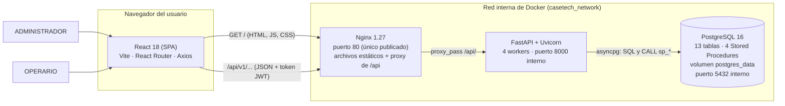
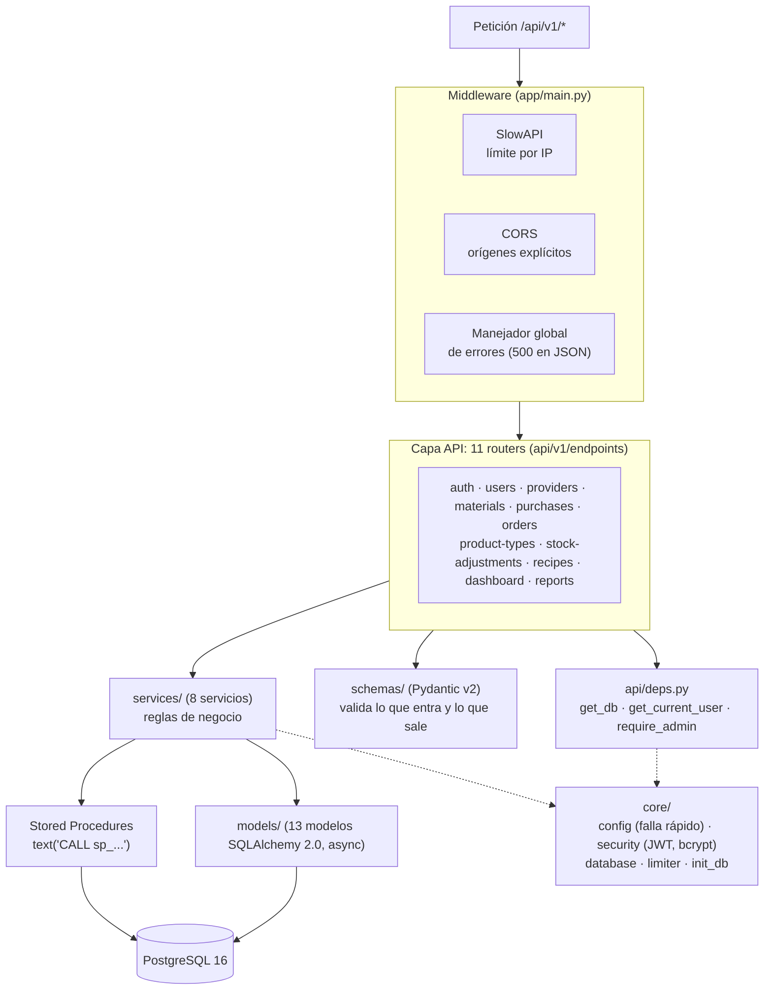
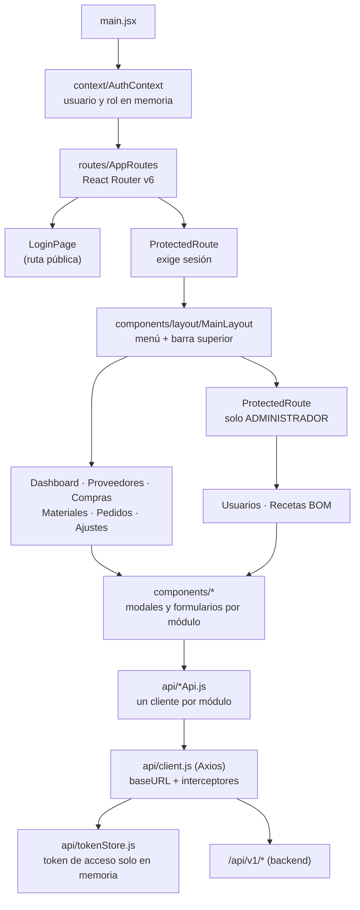
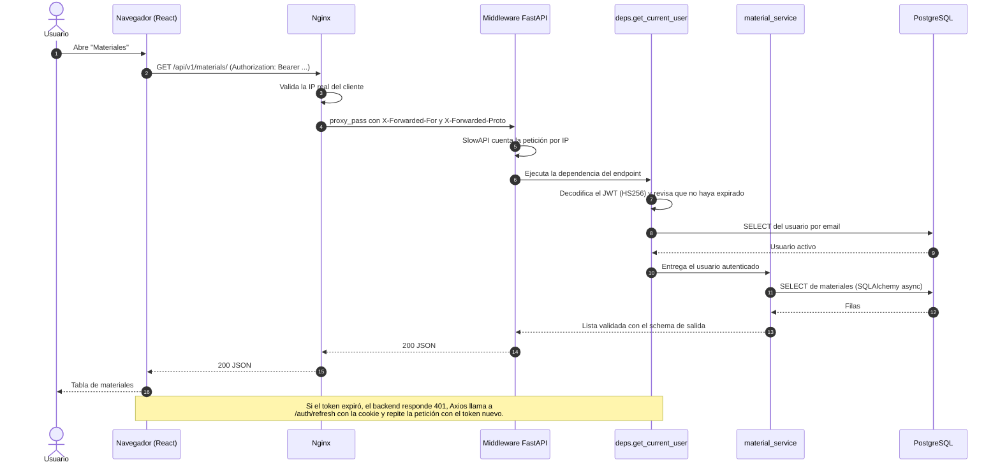
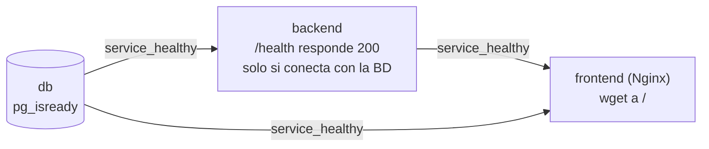
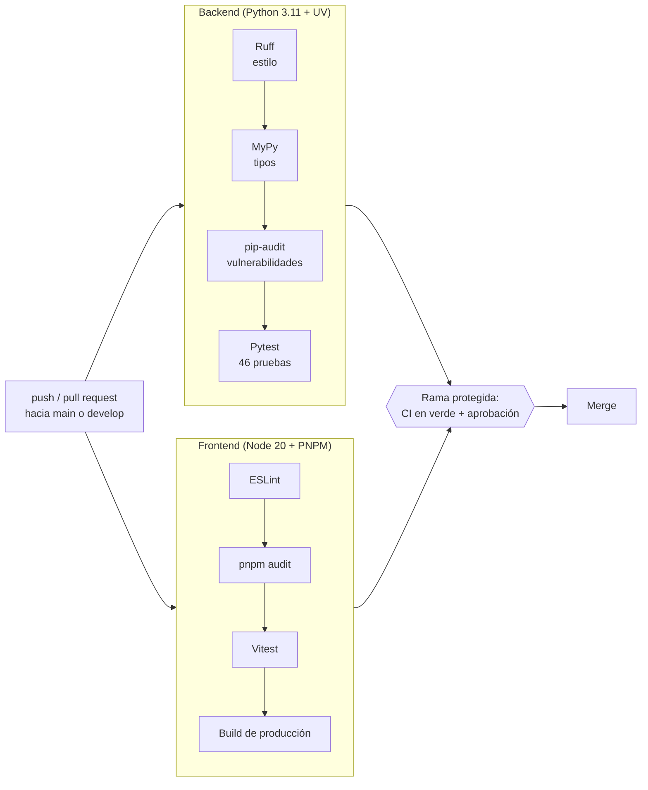

# 06 — Arquitectura del sistema

> **Versión:** 1.0.0 (corresponde a CASETECH ERP v1.6.3)
> **Equipo:** Andrés Fernández · Oscar Ruiz · Javier Sepúlveda
> **Propósito:** explicar de qué piezas está hecho CASETECH, cómo se comunican y por qué se decidió así.
> **Cómo se ve:** los diagramas están en [Mermaid](https://mermaid.js.org/); GitHub los dibuja al abrir este archivo.
> **Fuente de verdad:** se construyó leyendo el código real (`docker-compose*.yml`, `backend/app`, `frontend/src`, `.github/workflows/ci.yml`). Las versiones son las instaladas, no las del `pyproject.toml`.

## Tabla de contenidos

1. [Vista general: contenedores y comunicación](#1-vista-general-contenedores-y-comunicación)
2. [Arquitectura del backend (capas)](#2-arquitectura-del-backend-capas)
3. [Arquitectura del frontend](#3-arquitectura-del-frontend)
4. [Recorrido de una petición](#4-recorrido-de-una-petición)
5. [Despliegue: desarrollo vs. producción](#5-despliegue-desarrollo-vs-producción)
6. [Integración continua (CI)](#6-integración-continua-ci)
7. [Seguridad por capas](#7-seguridad-por-capas)
8. [Decisiones de arquitectura](#8-decisiones-de-arquitectura)
9. [Tecnologías y versiones](#9-tecnologías-y-versiones)
10. [Limitaciones conocidas](#10-limitaciones-conocidas)

---

## 1. Vista general: contenedores y comunicación

CASETECH es una aplicación de **tres capas** que corre en **tres contenedores Docker**: un navegador con la interfaz React, un servidor Nginx que entrega la interfaz y reenvía la API, un backend FastAPI con la lógica de negocio y una base de datos PostgreSQL con las tablas y los Stored Procedures (*procedimientos guardados en la base que ejecutan operaciones completas de forma atómica*).

**Qué entra y qué no desde el exterior:** solo el puerto del frontend (80) se publica. El backend y la base de datos solo se alcanzan desde dentro de la red de Docker.

| Flecha | Protocolo | Qué viaja |
|---|---|---|
| Navegador → Nginx | HTTP/HTTPS | Archivos de la interfaz y llamadas a `/api/v1/...` (JSON). El token de acceso va en `Authorization: Bearer`; el de renovación, en una cookie `httpOnly`. |
| Nginx → FastAPI | HTTP (red interna) | La misma petición, con `Host`, `X-Forwarded-For` (IP real del cliente) y `X-Forwarded-Proto`. |
| FastAPI → PostgreSQL | TCP con `asyncpg` | Consultas SQL (ORM) y llamadas `CALL sp_...` para las operaciones críticas de inventario. |

---

## 2. Arquitectura del backend (capas)

Cada petición atraviesa las mismas capas, de arriba hacia abajo. Cada capa tiene una sola responsabilidad:

| Capa | Carpeta | Responsabilidad | Regla clave |
|---|---|---|---|
| Middleware | `app/main.py` | Límite de intentos, CORS y errores no controlados | Un error imprevisto devuelve JSON genérico y deja el detalle solo en el log. |
| API | `app/api/v1/endpoints/` | Recibir la petición, declarar rutas y códigos HTTP | No contiene reglas de negocio: delega al servicio. |
| Dependencias | `app/api/deps.py` | Abrir la sesión de BD, identificar al usuario y exigir rol | `require_admin` protege lo exclusivo de ADMINISTRADOR. |
| Schemas | `app/schemas/` | Validar y dar forma a los datos (Pydantic v2) | Una contraseña nueva exige mayúscula y dígito, entre otras reglas. |
| Servicios | `app/services/` | Reglas de negocio de cada módulo | Todo es `async/await`. |
| Modelos | `app/models/` | Tablas como clases Python | Nombres de tablas y columnas en español; código en inglés. |
| Stored Procedures | `alembic/versions/*.sql` | `sp_descontar_receta`, `sp_revertir_receta`, `sp_ajuste_inventario`, `sp_crear_proveedor` | **Nunca** se replica su lógica en Python: se invocan con `text("CALL ...")`. Usan `SELECT ... FOR UPDATE` para que dos operaciones simultáneas no corrompan el stock. |
| Núcleo | `app/core/` | Configuración, seguridad, conexión a BD | Si falta una variable obligatoria, el backend no arranca y explica cuál. |

Las migraciones (Alembic, 8 en total) corren solas al arrancar el contenedor, antes de levantar uvicorn. Un cambio a un Stored Procedure ya migrado se hace con una **migración nueva** (`CREATE OR REPLACE PROCEDURE`), nunca editando una antigua.

---

## 3. Arquitectura del frontend

- **9 pantallas**, todas bajo `ProtectedRoute` excepto el login. `Usuarios` y `Recetas BOM` solo se muestran al ADMINISTRADOR.
- El **token de acceso vive solo en memoria** (`tokenStore.js`), no en `localStorage`: así un script malicioso no puede leerlo. La sesión sobrevive a un F5 gracias a la cookie `httpOnly` de renovación.
- `client.js` tiene dos interceptores: uno agrega el token a cada petición; otro, si el backend responde 401, intenta **renovar la sesión una vez** de forma silenciosa y repite la petición. Si la renovación falla, avisa que la sesión expiró.
- Los botones de envío de los formularios se activan solo cuando los datos son válidos (patrón `getValidationErrors()` → `isFormValid` → `disabled`), con una paleta de colores centralizada en `styles/buttons.js`.

---

## 4. Recorrido de una petición

Caso: un usuario autenticado abre la lista de materiales.

El detalle del login, el bloqueo de cuenta a los 5 intentos fallidos y la rotación del refresh token está en [`05-modelado-y-diagramas.md`, sección 5](./05-modelado-y-diagramas.md#5-diagramas-de-secuencia).

---

## 5. Despliegue: desarrollo vs. producción

Hay dos archivos de Docker Compose. Las diferencias están pensadas a propósito:

| | Desarrollo (`docker-compose.yml`) | Producción (`docker-compose.prod.yml`) |
|---|---|---|
| Puertos publicados | 3000 (interfaz), 8000 (API), 5432 (BD) | Solo el de Nginx (80, configurable) |
| Frontend | Servidor de Vite con recarga en vivo | Nginx con la interfaz ya compilada |
| Backend | Uvicorn con `--reload`, 1 proceso | 4 workers, sin recarga, usuario sin privilegios |
| Código | Carpeta montada en el contenedor | Copiado dentro de la imagen |
| Usuarios iniciales | Se siembran solos al arrancar | No se siembran: se crea el primero con `create_admin` |
| URL de la API | `http://localhost:8000` | Misma dirección del sitio (`/api/v1`) |

En producción, cada servicio espera a que el anterior esté **realmente sano**, no solo encendido:

Guía paso a paso, variables de entorno y problemas conocidos: [`07-despliegue.md`](./07-despliegue.md).

---

## 6. Integración continua (CI)

El archivo `.github/workflows/ci.yml` corre en cada *push* y *pull request* hacia `main` o `develop`, con dos trabajos independientes:

---

## 7. Seguridad por capas

| Capa | Medida | Dónde |
|---|---|---|
| Red | Solo Nginx publicado; backend y BD en red interna | `docker-compose.prod.yml` |
| Nginx | Cabeceras de seguridad (`X-Frame-Options`, `X-Content-Type-Options`, `Referrer-Policy`, `Permissions-Policy`); IP real del cliente validada para que no se pueda falsear `X-Forwarded-For` | `frontend/nginx.conf` |
| Contenedor | El backend corre como `appuser` (UID 10001), no como root | `backend/Dockerfile` |
| Configuración | Falla rápido si falta `JWT_SECRET` o `POSTGRES_PASSWORD`, o si tienen valores de ejemplo fuera de desarrollo | `app/core/config.py` |
| Autenticación | JWT HS256 de 30 min; contraseñas con bcrypt | `app/core/security.py` |
| Sesión | Refresh token de 7 días en cookie `httpOnly` + `Secure` + `SameSite=Lax`; en la BD solo se guarda su hash SHA-256; rota en cada uso | `endpoints/auth.py` |
| Fuerza bruta | Bloqueo de la cuenta tras 5 intentos fallidos (contador en la BD) y límite de 10 logins por minuto por IP | `endpoints/auth.py`, `core/limiter.py` |
| Autorización | Roles ADMINISTRADOR y OPERARIO; `require_admin` en el backend y `ProtectedRoute` en el frontend | `api/deps.py`, `routes/` |
| Datos | Schemas Pydantic validan toda entrada; SQLAlchemy usa consultas parametrizadas | `schemas/`, `services/` |
| Errores | Los errores imprevistos no filtran SQL ni rutas internas al cliente | `app/main.py` |
| Dependencias | `pip-audit` y `pnpm audit` en el CI; `uv.lock` y `pnpm-lock.yaml` versionados | `.github/workflows/ci.yml` |

---

## 8. Decisiones de arquitectura

| Decisión | Por qué | Costo o consecuencia |
|---|---|---|
| **Stored Procedures para inventario** | Descontar o devolver materiales debe ser atómico y soportar concurrencia: `SELECT ... FOR UPDATE` bloquea las filas mientras se calcula, y todo se confirma o se revierte junto. | La lógica vive en SQL, fuera de Python. Las pruebas con SQLite no pueden ejecutarla (ver sección 10). |
| **FastAPI + SQLAlchemy async** | Muchas peticiones concurrentes sin bloquear; validación y documentación automáticas con Pydantic. | Todo el código debe ser `async/await`. |
| **Nginx como proxy y servidor de la interfaz** | Un solo origen: no hay CORS en producción, la URL del backend no está escrita en el código y backend y BD no se exponen. | Hay que mantener `nginx.conf` y cuidar las cabeceras `X-Forwarded-*`. |
| **Token de acceso en memoria + refresh en cookie `httpOnly`** | Un ataque XSS no puede robar ninguno de los dos desde JavaScript. | Exige HTTPS en producción para que la cookie `Secure` se guarde. |
| **3FN (13 tablas normalizadas)** | Sin datos duplicados; el stock y los movimientos son trazables (Kardex y auditoría). | Más `JOIN` en consultas de reportes. |
| **Tests con SQLite en memoria** | Rápidos, sin servicios externos, cada prueba parte de una base limpia. | No ejercitan nada específico de PostgreSQL (Stored Procedures, bloqueos). |
| **Docker Compose en dos archivos** | Desarrollo cómodo (recarga en vivo) y producción endurecida, sin mezclar ambas. | Dos archivos que mantener alineados. |
| **UV y PNPM con lockfile** | Instalaciones reproducibles: todos instalan exactamente las mismas versiones. | Hay que regenerar el lock al cambiar una dependencia. |

---

## 9. Tecnologías y versiones

Versiones instaladas y verificadas (no los rangos de `pyproject.toml`).

| Capa | Tecnología | Versión |
|---|---|---|
| Base de datos | PostgreSQL | 16.15 |
| Backend | Python | 3.11 |
| | FastAPI / Starlette | 0.141.1 / 1.6.0 |
| | Uvicorn | 0.52.4 |
| | SQLAlchemy (async) + asyncpg | 2.0.52 + 0.31.0 |
| | Alembic | 1.19.1 |
| | Pydantic / pydantic-settings | 2.13.5 / 2.15.0 |
| | python-jose · bcrypt · slowapi | 3.5.0 · 5.0.0 · 0.1.10 |
| | Gestor de paquetes | UV 0.12.10 |
| Frontend | React / React DOM | 18.2.0 |
| | React Router | 6.22.3 |
| | Vite · Vitest · Axios | 5.x · 3.2.7 · 1.x |
| | Node · PNPM | 20 · 9.1.0 |
| Infraestructura | Nginx | 1.27 (Alpine) |
| | Docker Compose · GitHub Actions | — |
| Pruebas | Pytest + pytest-cov · Vitest · Playwright | — |

---

## 10. Limitaciones conocidas

Se listan a propósito: son decisiones o pendientes que un revisor debe conocer. Están priorizadas en el documento de deuda técnica.

| # | Limitación | Impacto | Mitigación actual |
|---|---|---|---|
| 1 | **Ninguna prueba automatizada ejecuta los 4 Stored Procedures.** Las pruebas usan SQLite, que no soporta `CALL`, y el servicio PostgreSQL que levanta el CI no lo usa ninguna prueba. | La lógica más crítica (descontar y revertir inventario) solo se ha verificado a mano contra PostgreSQL. | Verificación manual con arranque limpio (Issue #96). |
| 2 | El límite de intentos de login (slowapi) guarda sus contadores **en memoria de cada proceso**. Con 4 workers, cada uno cuenta aparte. | El límite real por IP es mayor al nominal de 10 por minuto. | El bloqueo de cuenta a los 5 intentos vive en la BD y sí es global. |
| 3 | **No hay HTTPS dentro del repositorio.** El certificado depende del dominio de cada despliegue. | Sin HTTPS la sesión no se puede renovar fuera de `localhost`. | Se documenta usar un proxy con TLS delante; Nginx y el backend ya respetan `X-Forwarded-Proto`. |
| 4 | Una sola instancia de PostgreSQL, sin réplicas ni copias de seguridad automáticas. | Si el volumen se pierde, se pierden los datos. | Ninguna dentro del repositorio. |
| 5 | Sin logs centralizados ni métricas; solo el endpoint `/health`. | Diagnosticar un problema en producción exige leer los logs de cada contenedor. | `/health` reporta el estado de la BD. |
| 6 | Las pruebas de extremo a extremo (Playwright) no corren en el CI. | Un cambio de interfaz puede romper un flujo sin que el CI lo detecte. | Se ejecutan a mano. |
| 7 | `pyproject.toml` usa rangos (`>=`) y `axios`/`vite` usan `^`, aunque la regla del proyecto es versión exacta. | Una instalación sin `uv.lock` podría traer versiones distintas. | `uv.lock` y `pnpm-lock.yaml` fijan las versiones reales. |
| 8 | El frontend llama a `/materials` (sin barra final) y FastAPI responde con una redirección 307 a `/materials/`. | Cada consulta de lista hace un viaje extra de red. | Funciona bien: Nginx conserva el puerto y el protocolo en la redirección. |
